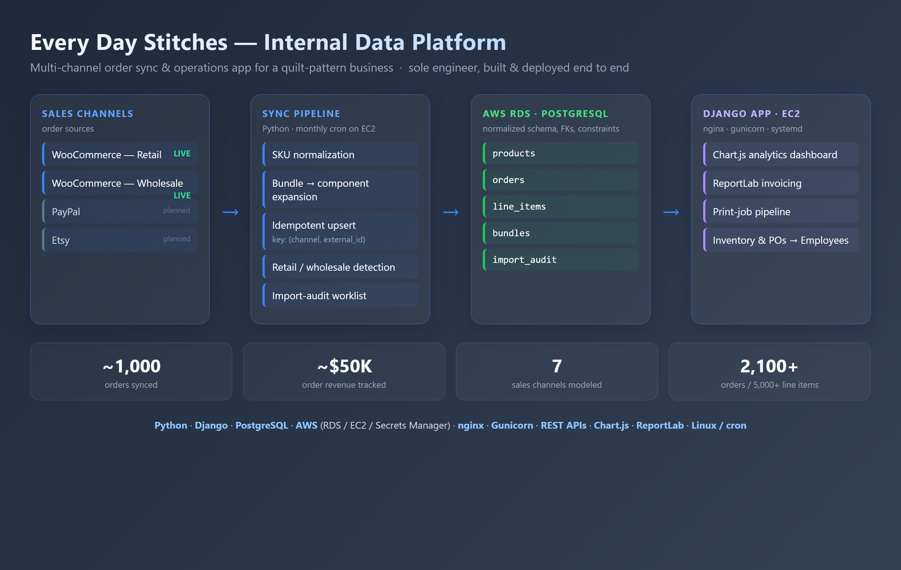

# Every Day Stitches — Internal Data Platform

An internal operations app and multi-channel order-sync pipeline for a
quilt-pattern business. It replaced a legacy Microsoft Access database with a
PostgreSQL data model on AWS RDS, a Django web app the owner and staff use to run
day-to-day operations, and an automated pipeline that pulls online sales into the
same database.

Built and deployed end to end by a single engineer: data model, ETL, web app,
and cloud infrastructure.



---

## What it does

- **Order management** — enter, edit, and track purchase orders; ship-and-bill
  with an automatic late-fee rule (1.5% per 30 days past the ship date, computed
  at bill time).
- **Analytics dashboard** — an interactive [Chart.js](https://www.chartjs.org/)
  view of monthly sales, revenue and units by channel, and top products, with
  legend filtering that re-sorts the charts live.
- **Automated invoicing** — [ReportLab](https://www.reportlab.com/) invoices and
  packing slips laid out to match the company's existing print templates.
- **Print-job pipeline** — tracks print POs through a configurable, linear
  workflow with guarded, reversible status transitions; receiving a job rolls its
  quantities into inventory (and undo reverses that safely).
- **Inventory & catalog** — product catalog (patterns, resale items, bundles),
  low-stock alerts, and inventory adjustments.
- **Sales sync** — a monthly pipeline imports retail and wholesale orders from
  the WooCommerce REST API (with PayPal and Etsy architected to follow), keyed so
  re-runs never duplicate. See [`sales-sync/`](sales-sync/README.md).
- **Import audit** — any SKU the sync can't resolve to a product or bundle lands
  on an admin worklist for manual triage, instead of being lost to logs.

## Architecture

```
Sales channels ──► Sync pipeline ──► PostgreSQL (RDS) ──► Django app (EC2) ──► Staff
  WooCommerce       Python, cron       products             nginx + gunicorn
  (PayPal, Etsy)    on EC2             orders               Chart.js dashboard
                                       line_items           ReportLab invoicing
                                       bundles              print-job workflow
                                       import_audit
```

- **Web tier:** Django served by Gunicorn behind nginx on an EC2 instance,
  managed by systemd.
- **Data tier:** PostgreSQL on AWS RDS. The Django models are `managed = False` —
  the database schema is the source of truth (owned outside Django), and the app
  maps onto it. This let an existing/shared database back the app without Django
  migrations.
- **Ingestion:** a self-contained pipeline in [`sales-sync/`](sales-sync/) runs on
  a monthly cron on the same EC2 box (deliberately not Lambda — that avoided a
  recurring NAT Gateway cost while keeping VPC access to RDS).
- **Secrets & config:** read from environment variables (`.env` locally,
  systemd `EnvironmentFile` in production); nothing sensitive is committed.

## Tech stack

**Backend:** Python, Django · **Database:** PostgreSQL (AWS RDS) ·
**Cloud / infra:** AWS EC2, RDS, Secrets Manager; nginx, Gunicorn, systemd, Linux, cron ·
**Frontend:** HTML/CSS, JavaScript, Chart.js · **Documents:** ReportLab (PDF) ·
**Integrations:** WooCommerce REST API

## Repository layout

```
ESAppProject/
├─ ESDB/                 Django project (settings, URLs, WSGI)
├─ dashboard/            main app — models, views, forms, templates, static
│  ├─ models.py          managed=False models mapping the RDS schema
│  ├─ views.py           order workflow, dashboard, invoicing, print jobs, audit
│  └─ static/ …          site CSS
├─ templates/            base + per-page templates
├─ sales-sync/           standalone order-sync pipeline (its own README)
│  ├─ shared/            mapping, DB upsert, bundle expansion, audit, SKU utils
│  ├─ tools/             woo_pull.py (manual/cron runner), monthly_sync.sh
│  ├─ functions/         AWS Lambda handler (alternative deploy target)
│  └─ migrations/        raw-SQL schema changes applied to RDS
├─ docs/                 diagrams and documentation assets
├─ requirements.txt
└─ manage.py
```

## Local development

Requires Python 3.11+ and access to a PostgreSQL database with the app's schema.

```bash
git clone <repo-url>
cd ESAppProject
python -m venv venv
source venv/bin/activate            # Windows: venv\Scripts\activate
pip install -r requirements.txt
```

Create a `.env` in the project root (it is gitignored):

```ini
DJANGO_SECRET_KEY=your-secret-key
DJANGO_DEBUG=True
DJANGO_ALLOWED_HOSTS=127.0.0.1,localhost
DB_NAME=postgres
DB_USER=your-db-user
DB_PASSWORD=your-db-password
DB_HOST=your-db-host
DB_PORT=5432
```

Then run the app:

```bash
python manage.py runserver
```

> The models are `managed = False`, so `migrate` is not used to create the
> application tables — the target database is expected to already have the
> schema. Django's own auth/session tables are the exception.

For the sales-sync pipeline (credentials, dry runs, scheduling), see
[`sales-sync/README.md`](sales-sync/README.md).

## Deployment

Production runs on a single EC2 instance: nginx proxies to Gunicorn (Unix
socket) under systemd, with configuration and secrets supplied via an
environment file. Static files are collected with `collectstatic` and served by
nginx. The deploy loop is pull-based:

```bash
git pull
pip install -r requirements.txt          # if dependencies changed
python manage.py collectstatic --noinput # if static/templates changed
sudo systemctl restart gunicorn
```

Schema changes are applied to RDS as raw SQL (the models are `managed = False`),
not via Django migrations.

---

*Internal business application, shared here as a portfolio showcase. Credentials,
infrastructure identifiers, and the client's real contact details have been removed
or replaced with placeholders.*

## License

Copyright © 2026 Tyler Price. All rights reserved. This code is published for
viewing only: it is not open source, and you may not copy, use, modify, or
redistribute it without written permission. See [LICENSE](LICENSE).
